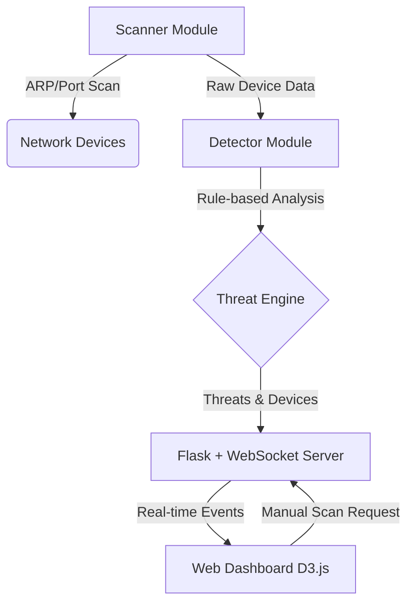

# 🌐 ProxNet

[](https://python.org)
[](https://flask.palletsprojects.com/)
[](https://opensource.org/licenses/MIT)

ProxNet is an AI-powered local network threat visualizer and monitoring dashboard. It scans your local network, identifies devices, detects potential threats or suspicious activities, and displays them on a dark-themed, real-time interactive web dashboard.

## 🚀 Features
- **ARP Network Scanning:** Discovers all active devices on your local network.
- **Device Identification:** Resolves MAC addresses to common vendors (e.g., Apple, Intel) and fingerprints OS via TTL.
- **Threat Detection:** Alerts on new devices, suspicious open ports (e.g., SMB 445), and potential ARP spoofing.
- **Real-time Web Dashboard:** Interactive D3.js network topology graph with live WebSocket updates.

## 🏗️ Architecture



## 🛠️ Installation

1. Clone or download this project.
2. Ensure you have Python installed.
3. Install the required dependencies:
   ```bash
   pip install -r requirements.txt
   ```

## 💻 Usage

**IMPORTANT:** Network scanning (via `scapy`) requires administrative privileges. You must run the application as Administrator (Windows) or root (Linux/Mac).

Run the main application:
```bash
python proxnet.py --interface Ethernet
```
Then, open your web browser and navigate to `http://localhost:5000`.

## 📸 Screenshots
*(Add your screenshots here after running the app!)*

## 🧠 What You'll Learn (Networking Concepts)
- **ARP (Address Resolution Protocol):** How IP addresses map to physical MAC addresses.
- **Port Scanning:** How checking open doors (ports) on a device reveals running services.
- **OS Fingerprinting:** How packet details (like TTL - Time To Live) hint at the underlying operating system.
- **Threat Analysis:** Why duplicate IPs with different MACs or certain open ports might indicate a cyber threat.

## 📄 License
This project is licensed under the MIT License - see the LICENSE file for details.
